# Correio Noturno

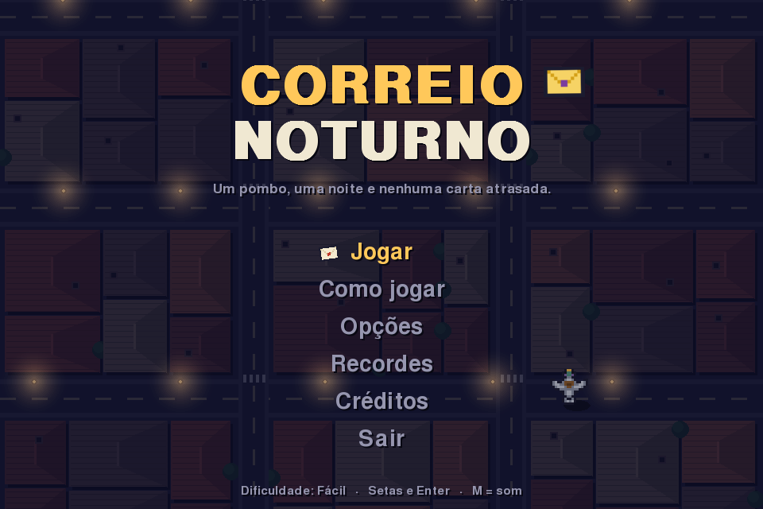

## 1. Identificação

| | |
|---|---|
| **Jogo** | Correio Noturno |
| **Grupo** | *(preencher o nome do grupo)* |
| **Disciplina** | Usabilidade, desenvolvimento web, mobile e jogos (USJT) |
| **Atividade** | A3 – Desenvolvimento de um Jogo |
| **Professores** | Elzo Brito dos Santos Filho e Patrícia Vitorino |

| Integrante | RA |
|---|---|
| Guilherme Loula Teixeira | 823144030 |
| Guilherme Pereira Nascimento Ferreira | 823122900 |
| Leandro Moises Vaz | 823150188 |
| Murilo Sabino F. De Melo | 824114526 |
| Taissa Almeida Souza De Jesus | 823144189 |
| Victor Hugo Luz Rodrigues Barbosa | 824147318 |

## 2. Descrição

Correio Noturno é um jogo de ação visto de cima. O jogador controla um pombo-correio que precisa recolher cartas espalhadas pelos telhados e entregá-las nas janelas acesas antes das 6h da manhã. A cidade rola para baixo, a noite passa num relógio na tela e o céu clareia aos poucos. São quatro fases, cada uma numa parte da cidade, com inimigos e obstáculos novos. Há cinco pombos jogáveis, cada um com um jeito diferente de jogar, e cada fase concluída libera um pombo novo.

**Premissa da história:** Bico é o pombo mais antigo da agência de correio de Vila Garoa e se aposenta na manhã seguinte. Antes de sair, precisa escolher quem vai herdar o seu quepe de carteiro-chefe. No último turno, uma tempestade rasga o malote e as cartas caem pela cidade. Até o sol nascer, alguém tem que entregar tudo, inclusive uma carta dourada endereçada à Dona Celeste, que mora no alto da Torre do Relógio.

Pelo caminho Bico conhece outros pombos (a aprendiz Pipoca, o grandalhão Tião e Neblina, do porto), que passam a poder ser escolhidos. Quem vencer a noite herda o quepe, por isso o final feliz muda conforme o pombo. A história aparece no jogo na introdução, nas falas do Bico antes de cada fase, na apresentação de cada pombo liberado e nos finais (vitória, amanhecer ou sem penas, com o desfecho da vitória diferente para cada pombo).

## 3. Como rodar

**Pré-requisitos:** Python 3.9 ou mais novo e o `pip`.

```bash
# 1. entrar na pasta do jogo
cd correio-noturno

# 2. (opcional) criar um ambiente virtual
python -m venv venv
venv\Scripts\activate        # Windows
source venv/bin/activate     # Linux / macOS

# 3. instalar as dependências
pip install -r requirements.txt

# 4. jogar
python main.py
```

O jogo abre numa janela de 960x640. F11 alterna para tela cheia. Recordes, opções e pombos liberados ficam salvos em `dados/` (a pasta é criada sozinha na primeira vez).

Os sprites e os sons já estão prontos em `assets/`. Os scripts que os criaram ficam em `tools/` e só precisam ser rodados de novo se alguém quiser mudar um desenho ou um som:

```bash
python tools/gerar_sprites.py   # recria assets/img/
python tools/gerar_sons.py      # recria assets/sons/ (leva uns 20 segundos)
```

### Versão para celular (extra)

Como o iPhone não roda Python, fizemos também uma versão web do mesmo jogo, em HTML5 Canvas, com controle por toque. Ela fica em `web/index.html` (um arquivo só, com imagens e sons embutidos) e abre em qualquer navegador. No celular, basta arrastar o dedo para voar e tocar no botão de raio para a arrancada. Para regerar o arquivo depois de mudar os assets: `python tools/gerar_web.py` (usa o ffmpeg, se tiver, para deixar os sons menores).

## 4. Controles

| Tecla | Ação |
|---|---|
| Setas ou W A S D | Voar |
| Espaço | Arrancada (desvio rápido; durante a arrancada o pombo não leva dano) |
| P ou Esc | Pausar / continuar |
| M | Ligar ou desligar o som |
| F11 | Tela cheia |
| F12 | Salvar uma captura de tela em `docs/capturas/` |
| Setas ← → (na seleção) | Escolher o pombo |
| Enter | Confirmar no menu / avançar os textos da história |
| Esc (na história) | Pular a história |

Os menus também funcionam com o mouse. Os controles aparecem dentro do jogo na tela "Como jogar" e no menu de pausa. Se a janela perder o foco, o jogo pausa sozinho.

## 5. Regras

**Objetivo:** cumprir a meta de entregas das quatro fases e, no fim, levar a carta dourada até a janela da Torre do Relógio antes das 6h.

- Cartas espalhadas pelos telhados são recolhidas ao passar por cima. Cabem 3 na bolsa.
- Uma janela acesa (com um envelope piscando em cima) recebe uma carta quando o pombo passa por ela. Depois ela apaga.
- Cada fase tem uma meta: 8 entregas no Bairro das Acácias, 9 no Centro, 10 no Porto e 8 na Torre do Relógio. Na última fase, depois da meta, a torre aparece e falta só entregar a carta dourada.

**Perigos**

| Perigo | Comportamento |
|---|---|
| Gato | Fica no telhado. Quando o pombo chega perto aparece um "!" e, meio segundo depois, ele dá o bote. |
| Fio elétrico | Fio azul dá choque. A partir da fase 2 alguns fios ligam e desligam: cinza é seguro, e ele pisca antes de religar. |
| Corvo | Aparece da fase 2 em diante e persegue o pombo. Se encostar, rouba uma carta da bolsa. Com a bolsa vazia, machuca. |
| Vento | Fases 3 e 4. Um aviso aparece na tela e logo depois uma rajada empurra o pombo para o lado. |
| Neblina | Fase 3. Nuvens passam pela tela e escondem o que está embaixo. |

Ao levar dano o pombo perde uma pena (vida), pisca por um tempo sem poder ser atingido de novo e derruba uma carta, que pode ser recolhida de volta.

**Pombos jogáveis**

| Pombo | Como joga | Como liberar |
|---|---|---|
| Bico, o veterano | Equilibrado: velocidade normal, bolsa para 3 cartas | Começa liberado |
| Pipoca, a aprendiz | 18% mais rápida e arrancada que recarrega quase duas vezes mais rápido, mas com uma pena a menos | Concluir a fase 1 |
| Tião, o grandalhão | 15% mais lento e maior (mais fácil de acertar), mas leva 4 cartas e tem uma pena a mais | Concluir a fase 2 |
| Neblina, a pomba do porto | Quase não sente o vento e a neblina quase não atrapalha, mas a bolsa só leva 2 cartas | Concluir a fase 3 |
| Dourado (secreto) | Um pouco melhor em tudo | Vencer o jogo |

Basta concluir a fase uma vez, com qualquer pombo e em qualquer dificuldade, mesmo que a partida termine em derrota depois. O progresso fica salvo em `dados/progresso.json`. Na tela de seleção, os pombos bloqueados aparecem como silhueta, com a dica de como liberar.

**Power-ups:** pão (voa 45% mais rápido por 6 s), lanterna (uma seta aponta a janela ou a carta mais próxima por 12 s e a neblina quase some) e asa extra (+1 pena, até 5).

**Como perder:** o relógio chega às 6h (final "O sol nasceu primeiro") ou as penas acabam (final "Bico ficou sem forças").

**Pontuação**

| Ação | Pontos |
|---|---|
| Recolher carta | 10 |
| Entregar carta | 100 |
| Entregas seguidas sem levar dano (combo) | +25 a cada entrega da sequência |
| Pegar power-up | 25 |
| Vencer: cada minuto que sobrou no relógio | 10 |
| Vencer: cada pena que sobrou | 200 |

Os 5 melhores resultados ficam salvos com as iniciais do jogador e o pombo usado.

**Dificuldade** (escolhida em Opções):

| Nível | Duração real da noite | Penas | Inimigos |
|---|---|---|---|
| Fácil | 5,5 min | 4 | mais lentos e raros |
| Normal | ~4 min | 3 | padrão |
| Difícil | ~3,3 min | 3 | 25% mais rápidos e frequentes |

Dentro de cada fase os inimigos aparecem com mais frequência conforme as entregas avançam.

## 6. Divisão de tarefas

*(ajustar para refletir o que cada um realmente fez)*

| Integrante | Responsabilidade | Arquivos principais |
|---|---|---|
| Guilherme Loula Teixeira | Personagens, inimigos, power-ups e colisões | `src/entidades.py` |
| Guilherme P. N. Ferreira | Laço principal, troca de telas, estados da partida e fases | `src/jogo.py`, `src/cenas/partida.py`, `src/config.py` |
| Leandro Moises Vaz | HUD, menus, recordes, README e versão web | `src/hud.py`, `src/ui.py`, `src/dados.py`, `src/cenas/menu.py`, `web/` |
| Murilo Sabino F. De Melo | Efeitos sonoros, músicas e controle de volume | `tools/gerar_sons.py`, `src/recursos.py`, `src/cenas/telas.py` (Opções) |
| Taissa Almeida Souza De Jesus | História, falas, finais, personagens e tela de seleção | `src/historia.py`, `src/cenas/narrativa.py`, `src/cenas/selecao.py`, `src/cenas/fim.py` |
| Victor Hugo Luz Rodrigues Barbosa | Sprites, cenário da cidade e efeitos visuais | `tools/gerar_sprites.py`, `src/cenario.py`, `src/efeitos.py` |

## 7. Créditos

O jogo não usa nenhuma imagem ou som de terceiros.

| Arquivo(s) | Autor | Licença |
|---|---|---|
| `assets/img/*.png` (os 5 pombos e seus retratos, corvo, gato, cartas, janelas, power-ups, poste, torre, retrato do Bico, ícone) | Criados pelo grupo como pixel art em código, no script `tools/gerar_sprites.py` | Do grupo |
| Cenário da cidade (telhados, ruas, porto) | Desenhado pelo grupo em tempo de execução, em `src/cenario.py` | Do grupo |
| `assets/sons/*.wav` (17 efeitos) | Criados pelo grupo por síntese de ondas, em `tools/gerar_sons.py` | Do grupo |
| `assets/sons/musica_menu.wav`, `musica_noite.wav`, `musica_madrugada.wav`, `musica_amanhecer.wav` | Compostas pelo grupo em código, em `tools/gerar_sons.py` | Do grupo |
| Fonte da versão pygame | Fonte padrão que vem com o pygame-ce (`freesansbold.ttf`, GNU FreeFont) | GPL com exceção para fontes |
| Fonte "Pixelify Sans" (só na versão web) | Stefie Justprince – [Google Fonts](https://fonts.google.com/specimen/Pixelify+Sans) | SIL Open Font License 1.1 |
| Fonte "Atkinson Hyperlegible" (só na versão web) | Braille Institute – [Google Fonts](https://fonts.google.com/specimen/Atkinson+Hyperlegible) | SIL Open Font License 1.1 |

## 8. Tecnologia

- **Linguagem:** Python 3
- **Biblioteca:** [pygame-ce](https://pyga.me/) (a mesma base das aulas)
- **Bibliotecas padrão usadas:** `json` (recordes e opções), `wave`, `array` e `math` (geração dos sons)
- **Versão web (extra):** HTML5 Canvas + JavaScript, sem bibliotecas. Fizemos porque o iPhone não roda Python. A lógica é a mesma da versão pygame, com tela em pé e controle por toque.

### Organização das pastas

```
correio-noturno/
├── main.py              ponto de entrada
├── requirements.txt
├── src/
│   ├── jogo.py          laço principal (entrada → atualizar → desenhar)
│   ├── config.py        tela, cores, dificuldades e fases
│   ├── entidades.py     pombo, cartas, janelas, gato, fio, corvo, power-ups, torre
│   ├── cenario.py       cidade gerada por código e o céu que clareia
│   ├── efeitos.py       partículas, tremor de tela, vento e neblina
│   ├── hud.py           barra com penas, bolsa, relógio e pontos
│   ├── historia.py      todos os textos da história
│   ├── recursos.py      carregamento de imagens, sons e fontes
│   ├── dados.py         salvar opções e recordes (JSON)
│   ├── ui.py            texto com sombra, painéis e menus
│   └── cenas/           menu, seleção de pombo, história, partida, fim, opções, recordes...
├── assets/
│   ├── img/             sprites (PNG)
│   └── sons/            efeitos e músicas (WAV)
├── tools/               scripts que geram sprites, sons e a versão web
├── web/                 versão para celular
└── docs/
    ├── capturas/        imagens do jogo
    └── GUIA_DO_CODIGO.md  explicação do código para a apresentação
```

## 9. Uso de IA

Usamos IA neste trabalho.

- **Ferramenta:** Claude (Anthropic), modelo Claude Opus 5.5, pelo app claude.ai.
- **Para quê:** gerar a primeira versão do código do jogo, dos scripts que desenham os sprites e sintetizam os sons e as músicas, da versão web e deste README; sugerir a ideia do jogo e o rascunho da história, que o grupo escolheu e ajustou; e criar um robô de teste que jogou partidas inteiras automaticamente para achar erros e calibrar a dificuldade (esse robô não faz parte da entrega).
- **Em quais arquivos:** todos os arquivos de `src/`, `tools/` e `web/`, além de `main.py`, `README.md` e `docs/GUIA_DO_CODIGO.md`. Os arquivos de `assets/` foram gerados pelos scripts de `tools/`.
- **O que o grupo fez:** escolheu a ideia entre as opções propostas, revisou e testou o jogo, *(completar com as mudanças feitas pelo grupo)* e estudou o código com o guia em `docs/GUIA_DO_CODIGO.md`, para que qualquer integrante consiga explicar ou alterar qualquer parte na apresentação.

## 10. Capturas de tela

| | |
|---|---|
| 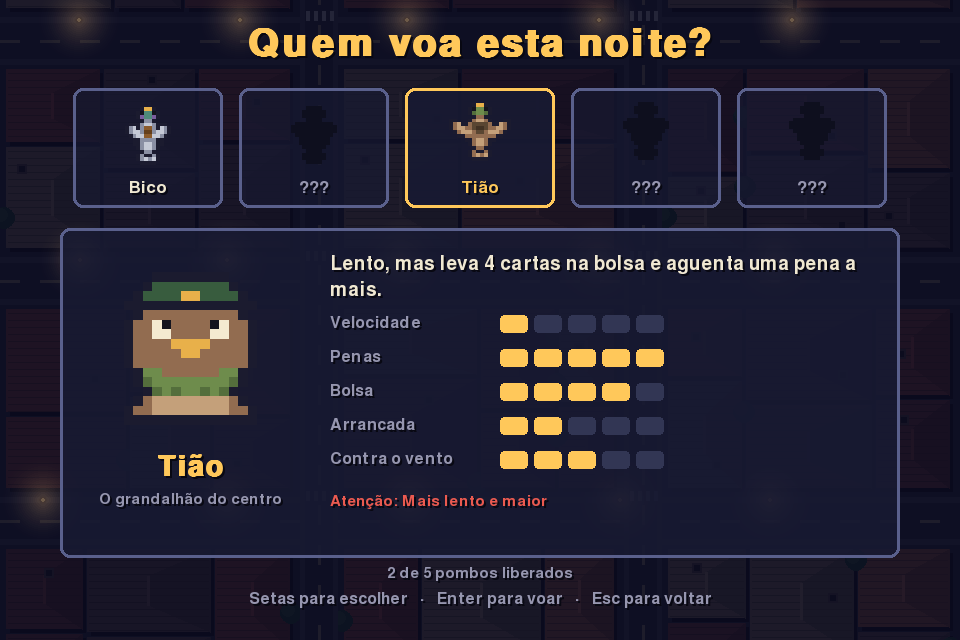 | 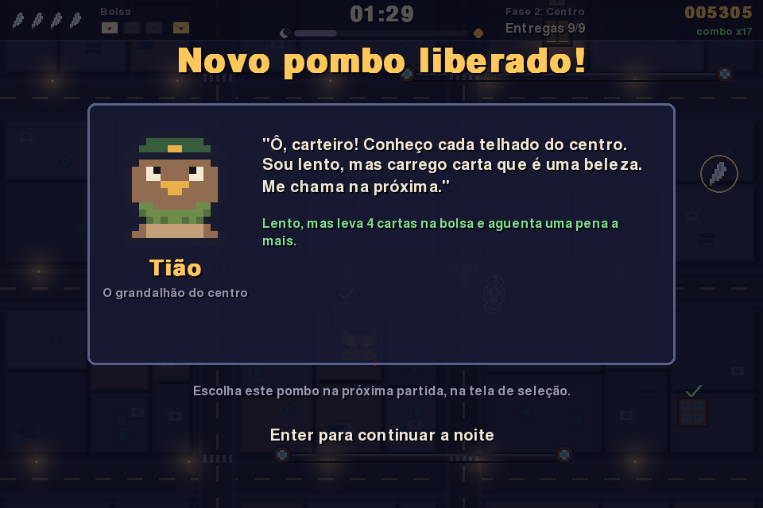 |
| Escolha do pombo (bloqueados em silhueta) | Pombo novo liberado ao concluir a fase |
| 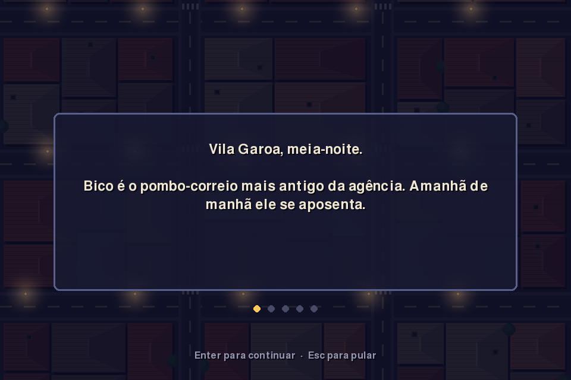 | 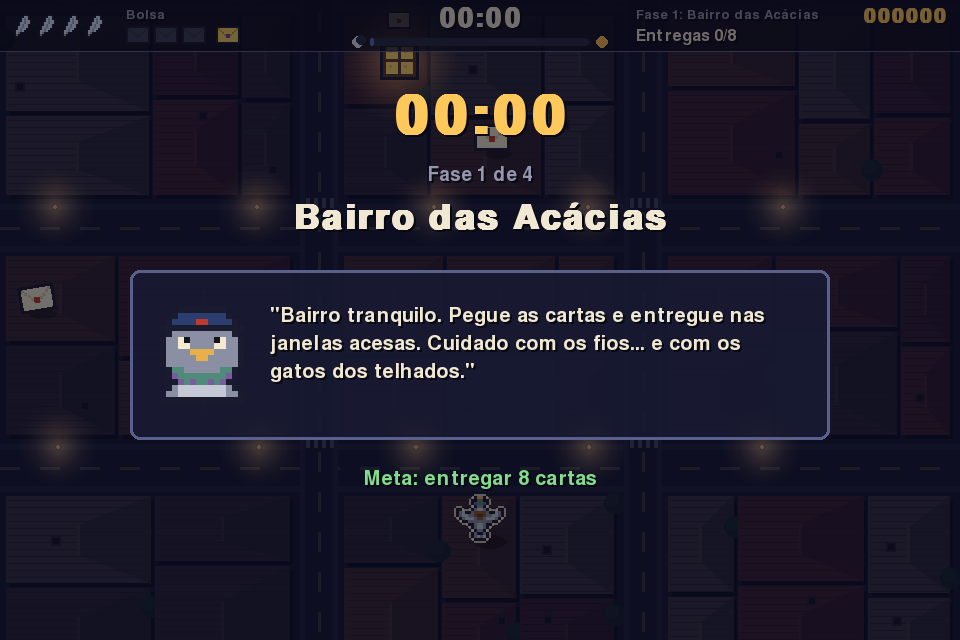 |
| Introdução da história | Fala do Bico antes da fase |
| 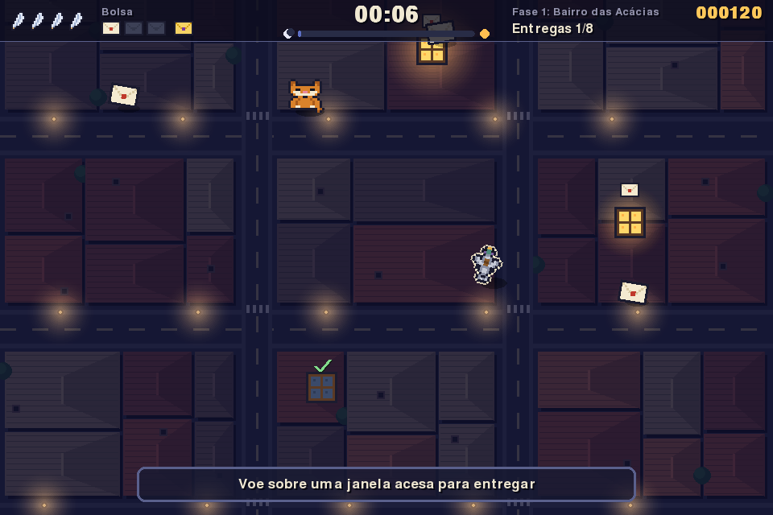 | 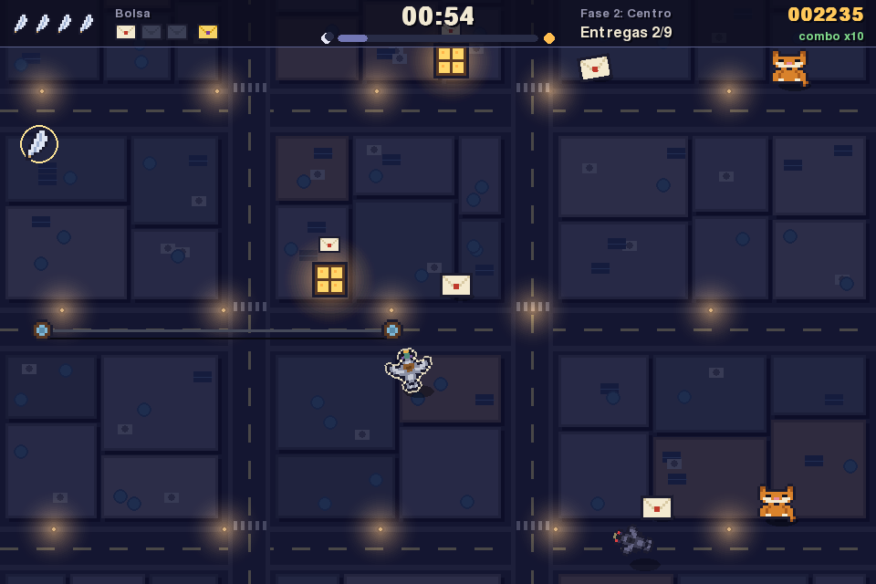 |
| Bairro das Acácias, com o tutorial | Centro, com corvos |
| 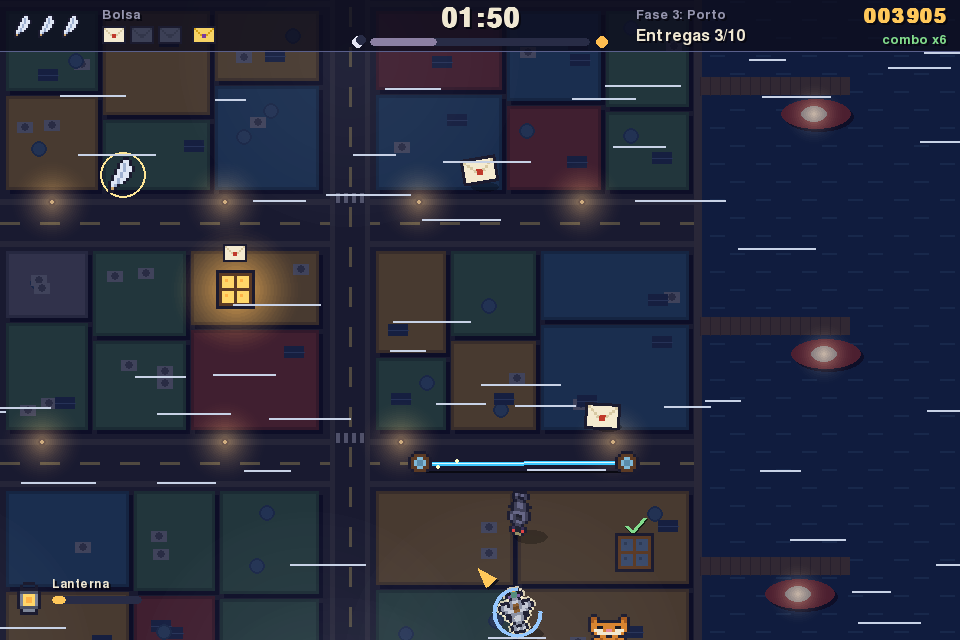 | 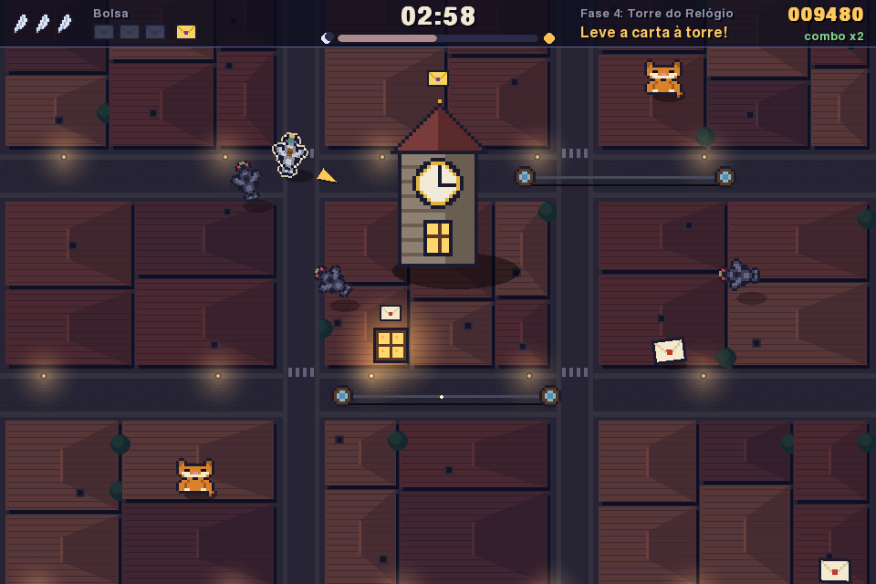 |
| Porto, com vento e neblina | A Torre do Relógio na última fase |
| 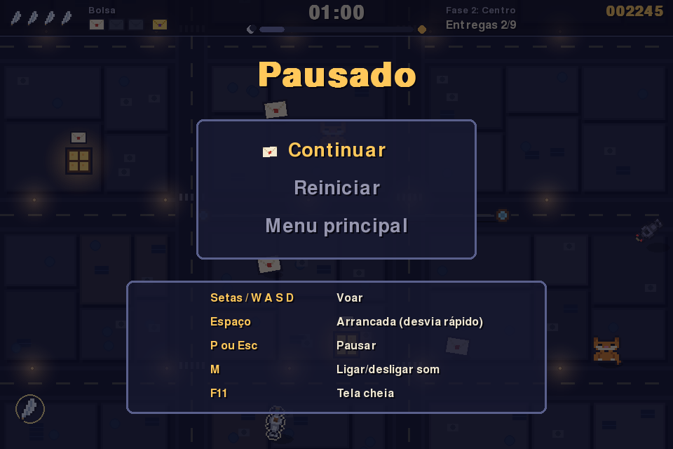 | 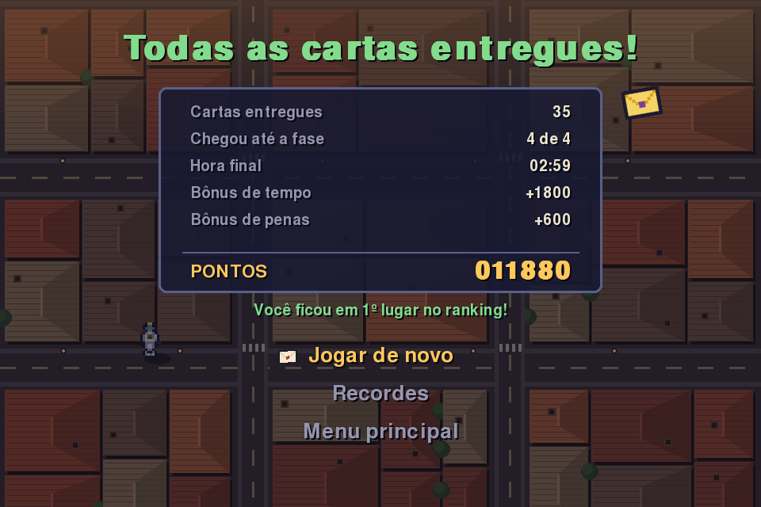 |
| Menu de pausa | Tela de fim com pontuação |

Versão para celular:

<p>
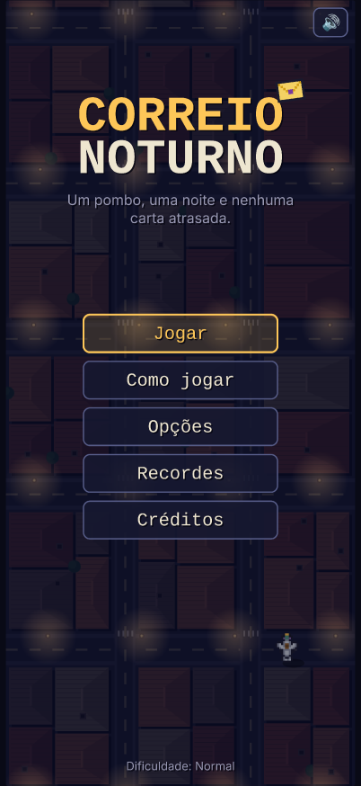
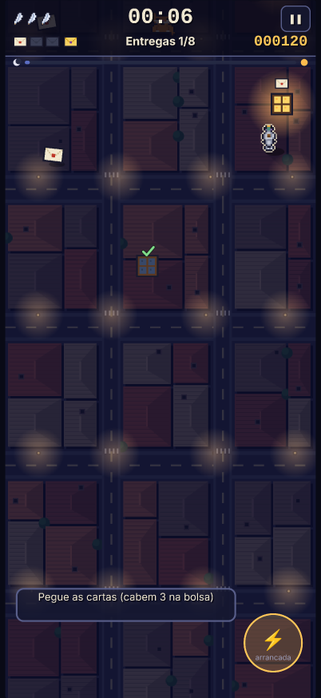
</p>
